# Отчёты Яндекс Метрики и Директа — без веб-интерфейса: скилл metrika-export

Когда интерфейс Метрики не открывается — из-за сбоя, перегрузки или просто
медленно, — ваши данные никуда не делись. У Метрики есть API: отдельный вход
для программ, который работает независимо от сайта metrika.yandex.ru. Этот
скилл забирает через него статистику и собирает готовые отчёты.

Что получится:

- **панель в браузере** — все ваши счётчики списком, напротив каждого кнопки
  «Сформировать SEO-отчёт» и «Сформировать Директ»;
- **SEO-отчёт** — поиск по методике Pixelplus (год к году, страницы, потерявшие
  трафик, длинные клики, цели из поиска) и весь трафик сайта;
- **отчёт по Яндекс Директу** — кампании, фразы, запросы, расход, цена клика и
  цена цели в разрезе часов, дней недели, возраста, пола, городов;
- каждый отчёт — **в трёх видах**: страница с графиками, Excel со всеми цифрами и
  PDF для клиента.

Отчёты считаются по главным целям — заявкам, покупкам, звонкам — и только по
людям, без роботов. Если Яндекс отстаёт с данными после сбоя, период сам
сдвигается на последний полный день.

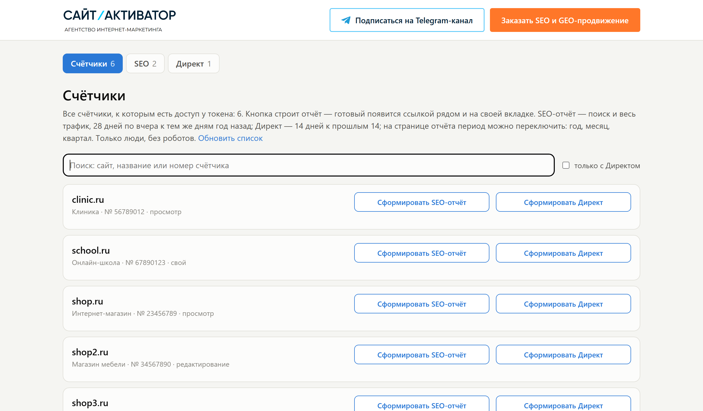

> Все скриншоты в этой инструкции — с настоящего сайта, обезличенного: адрес
> заменён на `site.ru`, страницы, фразы, кампании и цели переименованы, цифры
> настоящие.

---

## Оглавление

**Установка**

1. [Что понадобится](#что-понадобится)
2. [Шаг 1. Python](#шаг-1-python)
3. [Шаг 2. Папка скилла и библиотеки](#шаг-2-папка-скилла-и-библиотеки)
4. [Шаг 3. Токен Метрики](#шаг-3-токен-метрики)
5. [Шаг 4. Номер счётчика](#шаг-4-номер-счётчика)
6. [Шаг 5. Панель: отчёты по кнопке](#шаг-5-панель-отчёты-по-кнопке)

**Отчёты**

7. [SEO-отчёт: поиск и весь трафик](#seo-отчёт-поиск-и-весь-трафик)
8. [Отчёт по Яндекс Директу](#отчёт-по-яндекс-директу)
9. [Главные цели](#главные-цели)
10. [Сравнение: год, месяц, квартал](#сравнение-год-месяц-квартал)
11. [Если Метрика отстаёт с данными](#если-метрика-отстаёт-с-данными)
12. [PDF для клиента](#pdf-для-клиента)
13. [Только люди: роботы не считаются](#только-люди-роботы-не-считаются)

**Командная строка и подробности**

14. [Обычный отчёт Метрики в Excel](#обычный-отчёт-метрики-в-excel)
15. [Как читать Excel](#как-читать-excel)
16. [Свой отчёт: любые метрики и группировки](#свой-отчёт-любые-метрики-и-группировки)
17. [С Claude Code](#с-claude-code)
18. [Своя шапка: логотип и кнопки](#своя-шапка-логотип-и-кнопки)
19. [Лимиты и перегрузка API](#лимиты-и-перегрузка-api)
20. [Частые ошибки](#частые-ошибки)
21. [Куда уходят ваши данные](#куда-уходят-ваши-данные)

---

## Что понадобится

| Что | Зачем | Стоимость |
|---|---|---|
| Компьютер на Windows 10/11 или macOS | всё работает на нём | — |
| Python 3.10 или новее | запускает скрипт | бесплатно |
| Аккаунт Яндекса с доступом к счётчику | свой счётчик или тот, к которому вам дали доступ | бесплатно |
| Токен Метрики | пропуск к API, получается за 5 минут | бесплатно |
| Chrome или Edge | печатает PDF; без него всё остальное работает | бесплатно |

Claude Code и подписки **не нужны**: скрипт работает сам. Если Claude Code у
вас есть — он умеет запускать скилл и пересказывать отчёт
([раздел ниже](#с-claude-code)).

**Перед началом:** все команды вводятся в терминале.

- **Windows:** нажмите `Win`, наберите `PowerShell`, нажмите Enter.
- **macOS:** `Cmd + Пробел`, наберите `Терминал`, нажмите Enter.

Команду копируете, вставляете в окно терминала и нажимаете Enter.

---

## Шаг 1. Python

### Windows

1. Откройте [python.org/downloads](https://www.python.org/downloads/) и нажмите
   жёлтую кнопку **Download Python 3.x**.
2. Запустите скачанный файл.
3. **Важно:** на первом экране установщика поставьте галочку
   **Add python.exe to PATH** внизу окна.
4. Нажмите **Install Now** и дождитесь окончания.
5. **Закройте и заново откройте PowerShell.**

Или одной командой: `winget install -e --id Python.Python.3.12`

**Проверка:** `python --version` — должно быть `Python 3.10` или новее.

> **Если вместо версии открылся Microsoft Store** — откройте **Параметры →
> Приложения → Дополнительные параметры приложений → Псевдонимы выполнения
> приложений** и выключите `python.exe` и `python3.exe`. Потом откройте
> PowerShell заново.

### macOS

```bash
brew install python
```

Если команды `brew` нет — сначала установите Homebrew с сайта
[brew.sh](https://brew.sh). Проверка: `python3 --version`. На macOS везде ниже
пишите `python3` вместо `python`.

---

## Шаг 2. Папка скилла и библиотеки

1. Скопируйте папку `metrika-export` в удобное место, лучше без кириллицы и
   пробелов в пути: например, `C:\metrika-export`.

   | Файл | Что это |
   |---|---|
   | `run.py` | скрипт: выгрузка и отчёты |
   | `charts.py` | графики, страницы отчётов и PDF |
   | `panel.py` | панель в браузере: счётчики и кнопки отчётов |
   | `logo.png` | логотип в шапке панели и страниц отчётов |
   | `README.md` | этот файл |
   | `docs\img\` | скриншоты для этого файла; скрипту не нужны |
   | `SKILL.md` | инструкция для Claude Code |
   | `requirements.txt` | список библиотек |
   | `.env.example` | образец файла с токеном |
   | `.gitignore` | чтобы токен и выгрузки не попали в git |

2. Откройте терминал в этой папке:
   - **Windows 11:** в Проводнике правой кнопкой по пустому месту папки →
     **Открыть в терминале**;
   - **Windows 10:** в Проводнике кликните в адресную строку папки, наберите
     `powershell` и нажмите Enter;
   - или командой: `cd C:\metrika-export`.

3. Установите библиотеки:

   ```powershell
   python -m pip install -r requirements.txt
   ```

   Ставятся `requests` — для запросов к API, `openpyxl` — для Excel и `seaborn`
   — для графиков; вместе с ней приедут `matplotlib`, `pandas` и `numpy`. Это
   около 100 МБ, установка займёт минуту-две. В конце должно быть
   `Successfully installed …` или `Requirement already satisfied`. Строка
   `[notice] A new release of pip available` — не ошибка.

---

## Шаг 3. Токен Метрики

Токен — длинная строка, по которой API узнаёт, что запрос от вас. Получается
один раз и даёт **только чтение** статистики — изменить что-то в счётчике по нему
нельзя.

### 3.1. Создайте приложение

1. Откройте [oauth.yandex.ru/?dialog=create-client-entry](https://oauth.yandex.ru/?dialog=create-client-entry)
   и войдите в тот аккаунт Яндекса, у которого есть доступ к счётчику.
2. Выберите **«Для доступа к API или отладки»**.
3. Название — любое, например `metrika-export`. Почта — ваша.
4. В разделе доступов найдите **Яндекс Метрика** и отметьте
   **«Получение статистики, чтение параметров своих и доверенных счётчиков»**
   (`metrika:read`). Больше ничего не нужно.
5. Нажмите **«Создать приложение»** и скопируйте **ClientID** — строку из
   латинских букв и цифр.

### 3.2. Получите токен

Вставьте свой ClientID в адрес и откройте его в браузере:

```
https://oauth.yandex.ru/authorize?response_type=token&client_id=ВАШ_CLIENTID
```

Нажмите **«Разрешить»** — на странице появится токен. Скопируйте его целиком.

### 3.3. Положите токен в файл

В PowerShell, в папке скилла:

```powershell
Copy-Item .env.example .env
notepad .env
```

В Блокноте после `METRIKA_TOKEN=` вставьте токен без пробелов и кавычек:

```
METRIKA_TOKEN=y0_AgAAAA...
```

Сохраните (`Ctrl + S`) и закройте. На macOS: `cp .env.example .env && open -e .env`.

> **Ловушка Блокнота.** Через «Сохранить как» Блокнот добавит `.txt`, и
> получится `.env.txt` — скрипт его не увидит. Команда `Copy-Item` выше этой
> проблемы не имеет. Проверить: `dir -Force` — должен быть файл `.env`.

> **Никому не пересылайте токен и файл `.env`.** По токену можно читать
> статистику всех ваших счётчиков. Если он утёк — отзовите его на странице
> [«Доступ к данным»](https://id.yandex.ru/personal/data-access) в Яндекс ID
> или удалите приложение на [oauth.yandex.ru](https://oauth.yandex.ru): все
> выданные им токены перестанут действовать. Потом получите новый (шаг 3.2).

Токен перестаёт работать и сам: если вы сменили пароль, включили или
выключили двухфакторную защиту или нажали «Выйти на всех устройствах». Тогда
скрипт ответит `401` — просто получите токен заново.

**Расходы Директа по этому же токену.** Отдельного токена для Директа не нужно:
клики и расход скрипт берёт через ту же Метрику. Нужно одно — чтобы у аккаунта
Яндекса, от которого получен токен, был доступ к рекламному кабинету
([подробнее](#расходы-нужен-доступ-к-директу)).

---

## Шаг 4. Номер счётчика

```powershell
python run.py counters
```

Скрипт покажет все счётчики, к которым у вас есть доступ, — свои и те, что вам
открыли:

```
Доступно счётчиков: 3

     Номер  Доступ         Сайт
  12345678  свой           site.ru  — Мой сайт
  23456789  просмотр       shop.ru  — Магазин клиента
```

Тот же список сохранится в `data\counters.xlsx`. Номер счётчика — в первой
колонке. В панели (шаг 5) номер не нужен вовсе: там все счётчики уже списком, а в
командной строке вместо номера можно написать адрес сайта.

---

## Шаг 5. Панель: отчёты по кнопке

Главный способ работы со скиллом — панель в браузере:

```powershell
python run.py panel
```

Сама откроется страница `http://127.0.0.1:8790/`. Она работает только на вашем
компьютере: снаружи её не видно.


**Вкладка «Счётчики»** — все счётчики, к которым у токена есть доступ: адрес
сайта, название, номер и ваш уровень доступа. Напротив каждого две кнопки:

1. Нажмите **«Сформировать SEO-отчёт»** или **«Сформировать Директ»**.
2. Первый раз под счётчиком раскроется список его целей с галочками. Отметьте
   главные — те, ради которых работает сайт: заявку, покупку, звонок, до пяти
   ([зачем](#главные-цели)). Заявки и покупки стоят в списке первыми.
3. Под кнопкой побежит полоска и будет написано, какой лист выгружается сейчас.
   Отчёт собирается за несколько минут: запросов к API много, и скрипт делает
   их по одному.
4. Готово — рядом появится ссылка «Открыть отчёт», а сам отчёт — на вкладке
   «SEO» или «Директ».

Панель запомнит выбранные цели для этого счётчика — следующий отчёт запустится
сразу. Сменить цели — ссылка «сменить» под названием сайта.

Ещё на вкладке:

- **Поиск** над списком — по адресу сайта, названию или номеру счётчика.
- **«Директ подключён»** — метка у счётчиков, к рекламным кабинетам которых у
  токена есть доступ: только у них в отчёте по Директу будут расходы. Панель
  проверяет это сама при запуске и помнит сутки. Галочка «только с Директом»
  оставит в списке только их.
- **Одновременно** строятся не больше двух отчётов, остальные ждут в очереди: у
  API Метрики лимит — три запроса одновременно.

**Вкладки «SEO» и «Директ»** — все готовые отчёты своего вида, свежие сверху. У
каждого ссылки на страницу с графиками, Excel и PDF. Отчёты лежат в папке
`data\<номер>_<сайт>\` рядом со скриптом.

Терминал не закрывайте, пока пользуетесь панелью; остановить — `Ctrl + C`.
Порт занят — `python run.py panel --port 8791`.

---

## SEO-отчёт: поиск и весь трафик

Полный отчёт по сайту одной страницей и одним Excel, в двух разделах:

- **Поиск** — пять срезов, которые SEO-специалисты смотрят чаще всего, по статье
  [Pixelplus «Яндекс Метрика для SEO»](https://pixelplus.ru/samostoyatelno/stati/povedencheskie-faktory/yandex-metrika-seo.html);
- **Весь трафик** — источники, фразы, реклама, UTM, страницы, цели, устройства,
  география.

По умолчанию — **последние 28 дней по вчера против тех же дней год назад**. Год
назад сдвинут ровно на 52 недели: в обоих периодах одинаковые дни недели,
выходные не съезжают, и сравнение честное. Сегодняшний день не берётся: он ещё не
закончился, и Метрика досчитывает его с задержкой — он всегда выглядел бы провалом.

### Шапка отчёта

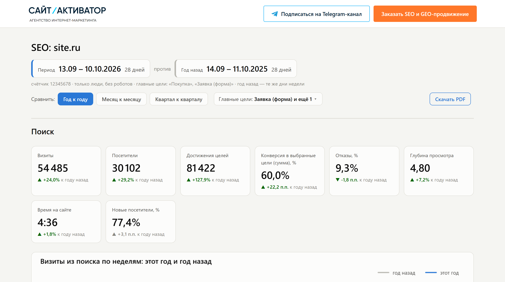

- **Периоды** — крупно, с числом дней: какой период смотрим и с каким сравниваем.
- **Строка под ними** — номер счётчика, «только люди, без роботов» и главные цели,
  по которым посчитан отчёт.
- **Кнопки «Год к году», «Месяц к месяцу», «Квартал к кварталу»** пересчитывают
  отчёт за другой период ([подробнее](#сравнение-год-месяц-квартал)).
- **«Главные цели»** — список целей с галочками и кнопкой «Пересчитать».
- **«Скачать PDF»** — та же страница на листах A4 ([подробнее](#pdf-для-клиента)).
- **Плитки** — главные цифры поиска и изменение: зелёным — стало лучше, красным —
  хуже. Рост отказов — красный, хотя число выросло. Для долей в процентах (отказы,
  конверсия) изменение — в процентных пунктах: отказы 20 % → 22 % — это «+2,0 п.п.».

### Раздел «Поиск»

Здесь только визиты из поисковых систем.

**Визиты из поиска по неделям.** Синим — этот год, серым — год назад. Ниже,
отдельной панелью, — достижения главных целей: оранжевым этот год, серым
пунктиром год назад. Недели — блоки по 7 дней от начала периода, так что все
недели полные. При «Месяц к месяцу» график строится по дням.

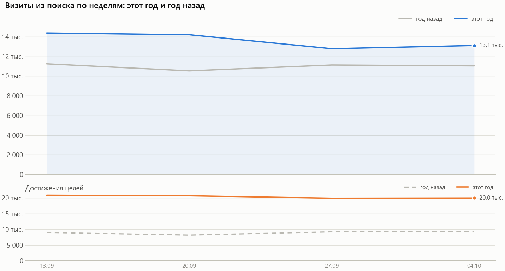

**Что изменилось за год.** Все показатели поиска одним графиком: на сколько
процентов или процентных пунктов они сдвинулись. Зелёным — к лучшему.

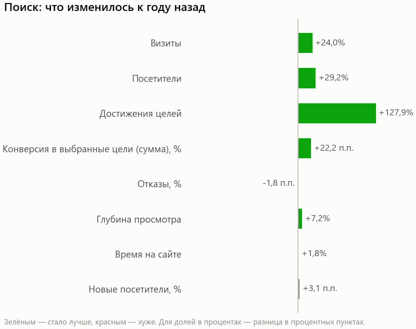

**Источники трафика год к году.** Какой канал вырос, а какой просел: поиск,
реклама, прямые заходы, ссылки, соцсети.

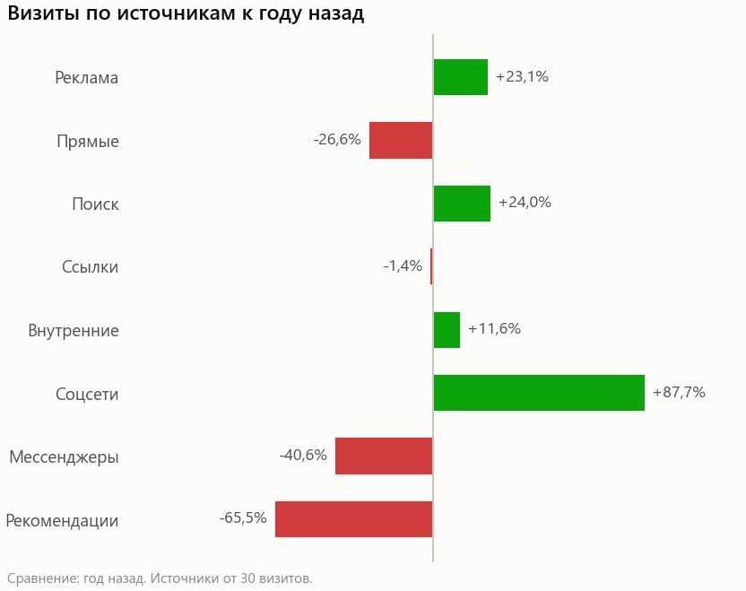

**Страницы входа из поиска.** На какие страницы приходят из поиска и сколько
целей они дают — визиты и достижения целей рядом.

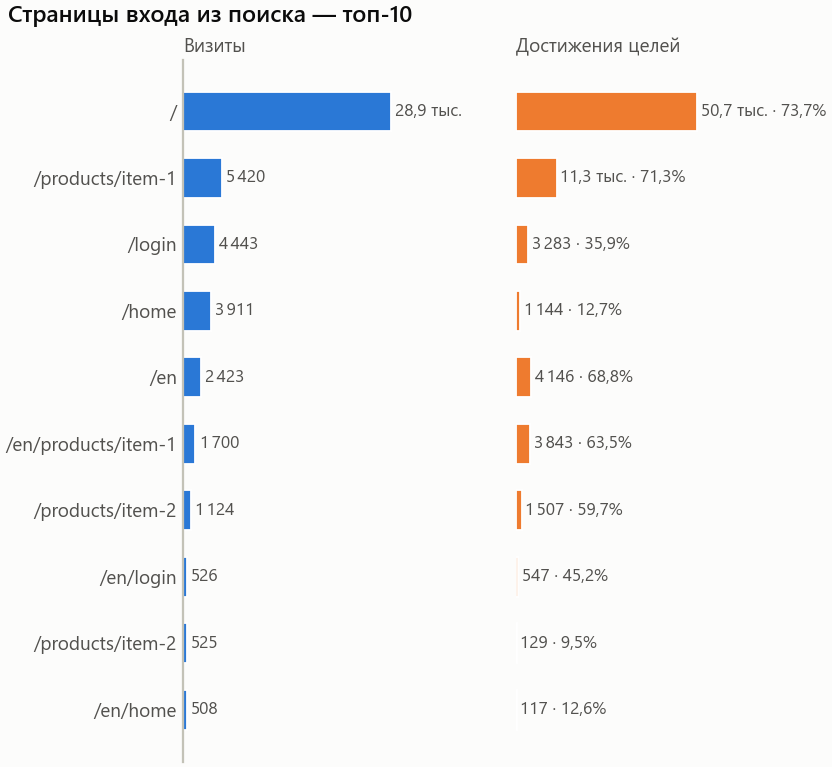

**Страницы, потерявшие визиты из поиска.** Самый полезный график для SEO: на
сколько визитов из поиска у страницы меньше, чем год назад. С этих страниц
начинают разбор просадки — проверяют позиции, сниппет, изменения на странице.

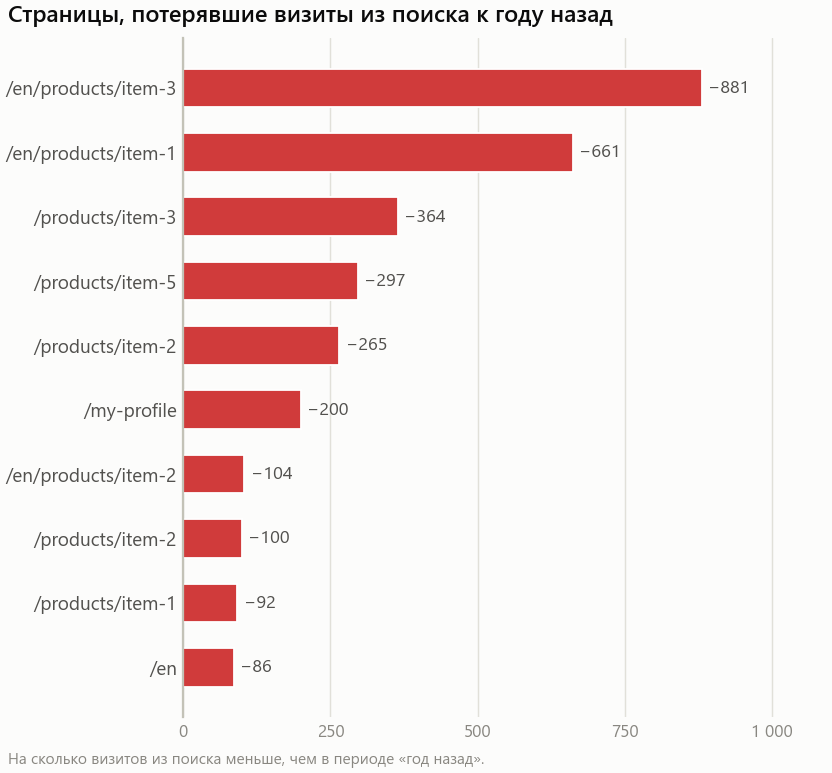

**Длинные клики.** По каждой фразе из Яндекса — доля визитов дольше 59 секунд.
Норма — от 10–15 %; фразы ниже 10 % окрашены красным: человек пришёл, не нашёл
ответа и ушёл. На графике фразы от 10 визитов, по убыванию визитов.

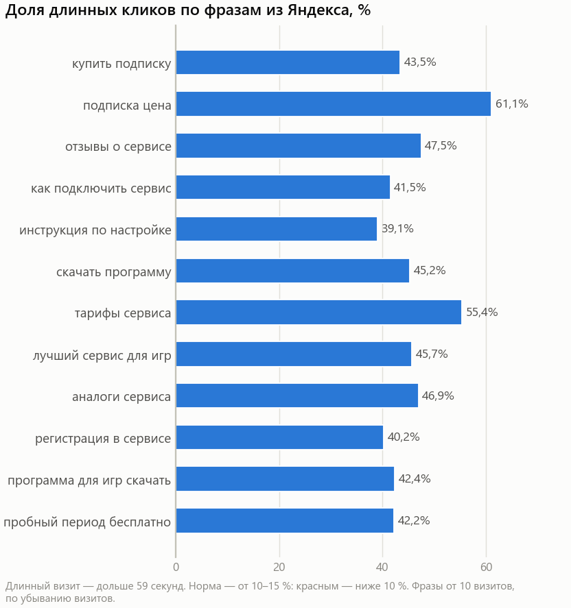

Если у фразы десятки визитов, а длинных — ноль, это не ошибка: визиты по ней
длятся по 0–2 секунды. Роботов скилл уже исключил, так что это либо незамеченные
Метрикой боты, либо запрос, ответ на который виден прямо в выдаче. Такие фразы
стоит проверить отдельно. Фразы, которые Метрика отдаёт с разным регистром
(«Как…» и «как…»), склеены в одну.

**Цели из поиска.** Конверсия в главные цели по поисковым системам: Яндекс,
Google и другие.

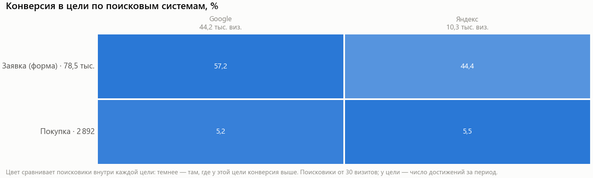

### Раздел «Весь трафик»

Всё то же, что в обычном отчёте Метрики: источники, поисковые системы, фразы,
сайты-источники, реклама, соцсети, страницы входа, цели, устройства, города. Пара
примеров.

**Визиты и цели по источникам** — слева визиты, справа достижения главных целей и
конверсия.

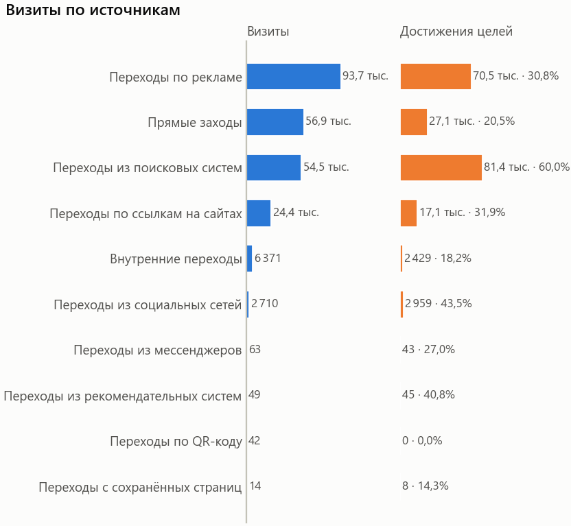

**Конверсия по источникам** — только источники от 100 визитов, остальные — шум.

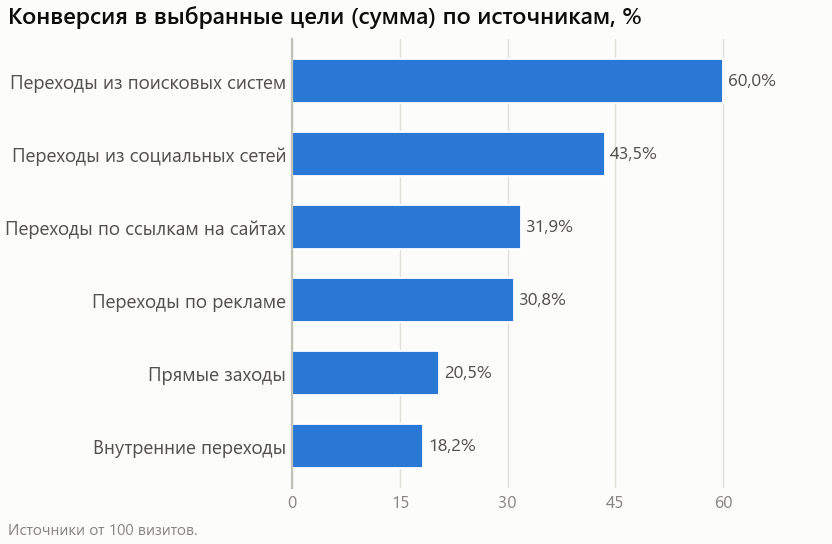

**Цели × источники** — тепловая карта: строки — цели, столбцы — источники, в
клетке конверсия. Цвет сравнивает источники внутри одной цели: темнее — где у
этой цели конверсия выше.

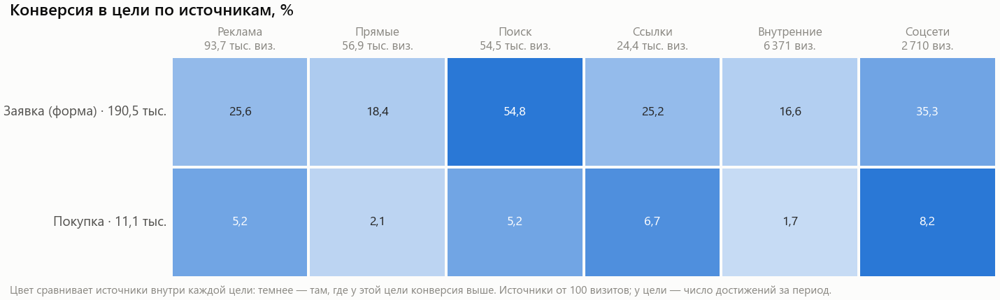

### Листы Excel

Файл `seo_<сайт>_<начало>_<конец>.xlsx`:

| Лист | Что на нём |
|---|---|
| **Сводка** | только визиты из поиска: сейчас, в сравниваемом периоде, изменение; ниже — список всех листов |
| Источники — сравнение | каждый источник трафика: визиты, отказы, глубина, время, цели — сейчас, для сравнения и изменение |
| Поиск в динамике | визиты из поиска по неделям (при «месяц к месяцу» — по дням): всего, Яндекс, Google — против сравниваемого периода |
| Страницы входа из поиска | на какие страницы приходят из поиска: визиты, отказы, глубина, время, цели и визиты для сравнения |
| Фразы и страницы | поисковая фраза и страница, на которую по ней пришли: посетители, отказы, глубина, время |
| Длинные клики | по каждой фразе из Яндекса — доля визитов дольше 59 секунд; ниже нормы — в колонке «Оценка» красным |
| Цели из поиска | каждая цель по поисковым системам: достижения, доля, конверсия |
| **Весь трафик — сводка** и дальше | все листы обычного отчёта Метрики — [список ниже](#обычный-отчёт-метрики-в-excel) |

### Из командной строки

```powershell
python run.py seo 12345678 --goal "Заявка"
```

| Команда | Что делает |
|---|---|
| `python run.py seo site.ru --goal 87654321` | счётчик по адресу сайта, цель по номеру |
| `python run.py seo 12345678 --days 84 --goal "Заявка,Покупка"` | 84 дня (12 недель) по вчера против тех же дней год назад, две главные цели |
| `python run.py seo 12345678 --compare mom --goal 87654321` | последний полный месяц против предыдущего |
| `python run.py seo 12345678 --from 2026-09-07 --to 2026-10-04 --goal 87654321` | точный период; год назад — минус 364 дня |
| `python run.py seo 12345678 --only long,entry --goal 87654321` | из листов поиска только нужные: `sources`, `weeks`, `entry`, `phrases`, `long`, `goals`; весь трафик выгружается всегда |

---

## Отчёт по Яндекс Директу

Отдельный отчёт только по рекламе в Директе. По умолчанию — **последние 14 дней
по вчера против 14 дней перед ними**: Директ смотрят короткими периодами.

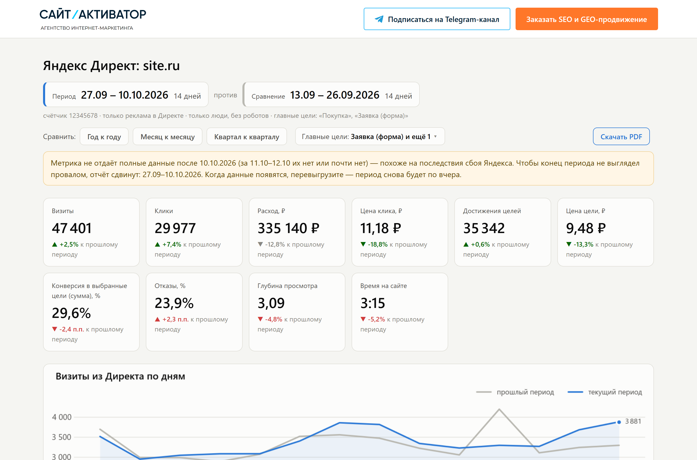

**Плитки** — визиты, клики, расход, цена клика, достижения главных целей, цена
цели, конверсия и поведение. Жёлтая плашка на этом скриншоте — период сдвинут,
потому что Метрика ещё не отдала данные после сбоя
([подробнее](#если-метрика-отстаёт-с-данными)).

### Деньги и цели по дням

**Визиты из Директа по дням** — текущий период синим, прошлый серым; ниже —
достижения главных целей.

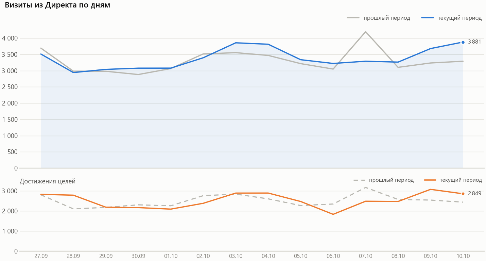

**Расход по дням** — сколько ушло денег, против прошлого периода.

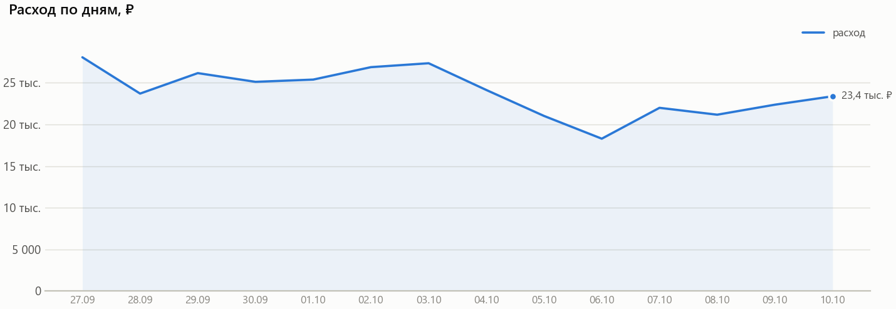

**Цена каждой главной цели** — весь расход Директа за период, делённый на
достижения этой цели. Если выбрано несколько целей, видно, сколько стоит каждая.

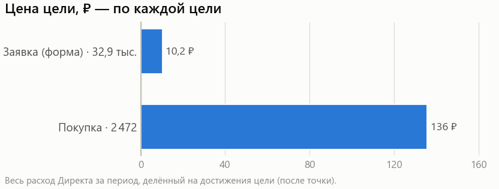

### Кампании

**Кампании** — визиты и достижения главных целей по каждой кампании. Рядом на
странице — расход по кампаниям и цена цели по кампаниям: дешёвые сверху.

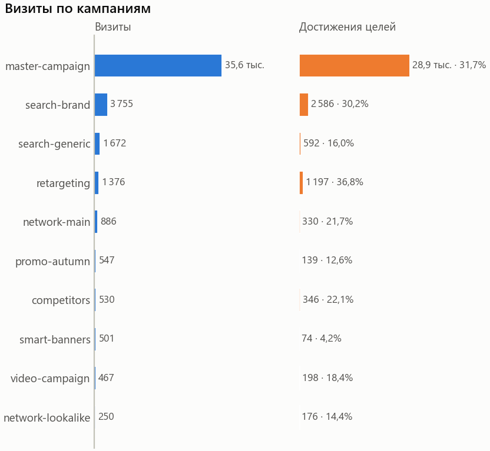

**Цели × кампании** — тепловая карта: какая кампания лучше конвертирует в каждую
цель.

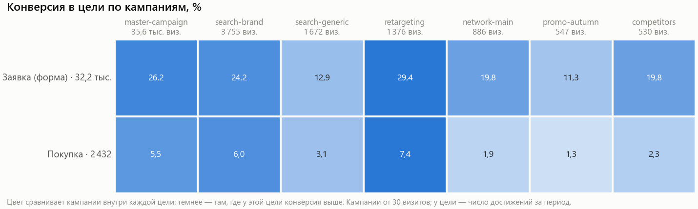

### Когда и кому показывать рекламу

Часы суток, дни недели, возраст, пол, новые и вернувшиеся посетители — каждый
срез четырьмя графиками друг под другом:

1. **Визиты.**
2. **Расход.**
3. **Цена цели**: зелёным — дешевле средней по отчёту, красным — дороже. Средняя —
   пунктирной линией.
4. **Конверсия** — на сколько процентных пунктов она выше (зелёным) или ниже
   (красным) средней.

По ним настраивают корректировки ставок: поднять там, где цели дешёвые, и
снизить, где дорогие.

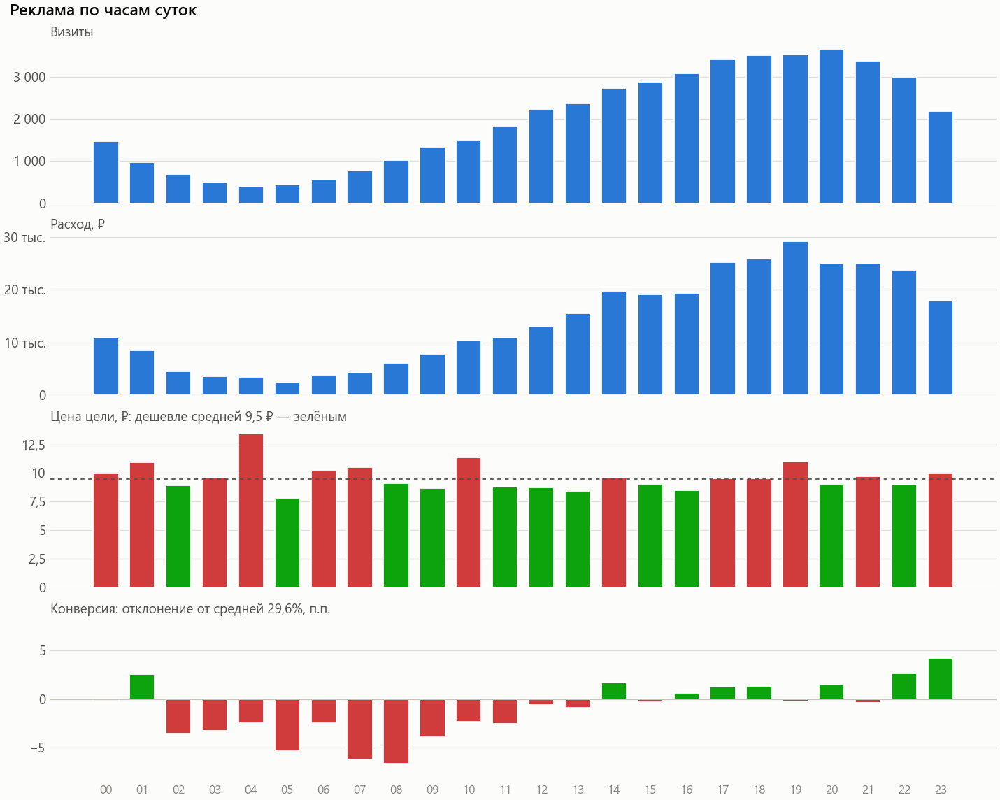

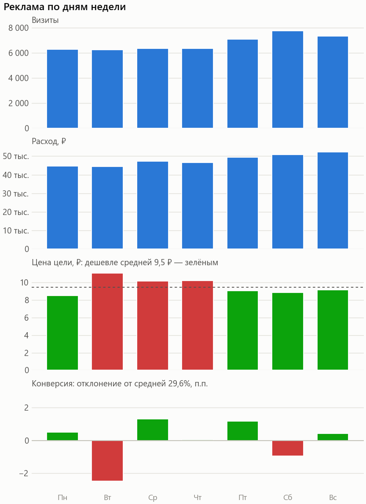

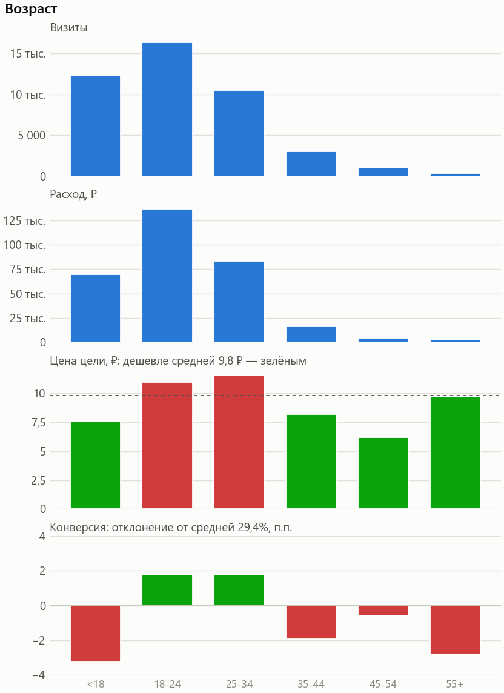

**Города в деньгах** — расход по городам, топ-10; после точки — цена цели в
городе.

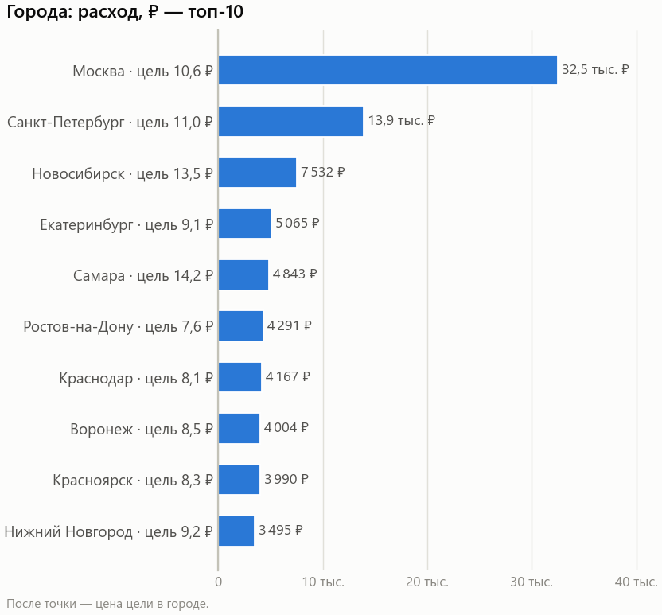

### Автотаргетинг против ключевых фраз

Сколько визитов и какую конверсию дал автотаргетинг, а сколько — ключевые фразы.
Скилл различает их по метке `utm_term`: у автотаргетинга Директ подставляет
`---autotargeting`. Визиты из кампаний, где фраза в метку не подставляется,
указаны в подписи отдельно.

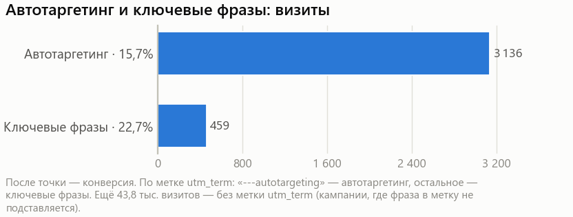

Ещё на странице: что изменилось к прошлому периоду, поиск и сети, страницы входа,
ключевые фразы и поисковые запросы.

### Листы Excel

Файл `direct_<сайт>_<начало>_<конец>.xlsx`:

| Лист | Что на нём |
|---|---|
| **Сводка** | визиты из Директа, поведение, достижения целей и конверсия; если доступны расходы — клики, расход, цена клика и цена цели. Всё — с прошлым периодом и изменением |
| Динамика | по дням, неделям или месяцам; с расходом |
| Кампании | каждая кампания с номером: визиты, отказы, цели, конверсия, клики, расход, цена клика, цена цели |
| Поиск и сети | поиск Яндекса против Рекламной сети |
| Объявления | каждое объявление с номером |
| Ключевые фразы | фразы и условия ретаргетинга, по которым показано объявление |
| Поисковые запросы | что человек на самом деле искал перед кликом |
| Площадки | где показано объявление: поиск, сайты и приложения Рекламной сети |
| Цели по кампаниям | каждая цель по кампаниям: достижения, доля кампании в цели, конверсия, цена цели |
| Цена целей | цена каждой главной цели: весь расход, делённый на её достижения |
| Кампании, Объявления, Фразы по UTM | то же по меткам `utm_campaign`, `utm_content`, `utm_term` |
| Автотаргетинг и фразы | сколько визитов и целей дал автотаргетинг, а сколько — ключевые фразы |
| Цели по кампаниям UTM | каждая цель по `utm_campaign` |
| Часы, Дни недели | визиты, расход и цена цели по времени — для корректировок ставок |
| Пол, Возраст, Новые и вернувшиеся | кто приходит из рекламы и почём — для корректировок по аудитории |
| Страницы входа, Устройства, Города | куда приводит реклама, с каких устройств и откуда |

**Визиты и цели** — данные Метрики: визиты, у которых последний значимый переход
— реклама Директа. **Клики и расход** — данные самого Директа. Кликов и визитов
поровну не бывает: часть людей уходит раньше, чем загрузится счётчик, — тогда
кликов больше; а повторные прямые заходы после рекламы Метрика засчитывает
Директу как последнему значимому переходу — тогда больше визитов.

**UTM-метки — запасной путь.** Кампании, объявления и фразы Директа Метрика берёт
из справочников Директа; когда они недоступны (так было после сбоя Яндекса
12.10.2026 — API отвечало 503), эти листы будут «не получено». Метки же —
обычные данные Метрики, и если в объявлениях стоят `utm_campaign`, `utm_content`,
`utm_term`, кампании и фразы будут в отчёте всё равно — страница сама возьмёт их
из меток. В хвостах адресов страниц входа меток нет: Метрика их вырезает.

### Расходы: нужен доступ к Директу

Визиты, фразы и цели скрипт выгрузит всегда. Клики и расход — только если у
аккаунта Яндекса, от которого получен токен, есть доступ к кампаниям Директа:
это ваш аккаунт Директа, вы в нём представитель или вы агентство клиента.
Подсказка: если в интерфейсе Метрики у вас открывается отчёт «Директ, расходы» с
цифрами — скрипт тоже их увидит. В панели у таких счётчиков стоит метка «Директ
подключён».

Скрипт сам находит аккаунты Директа, связанные со счётчиком, и пишет при запуске:

```
   расходы: 2 аккаунт(а) Директа
```

Если доступа нет — отчёт соберётся без расходов, а в Сводке и на странице будет
жёлтая подсказка. Чтобы взять расходы только из одного аккаунта, укажите его:
`--login логин-в-директе`.

### Из командной строки

```powershell
python run.py direct 12345678 --goal "Заявка"
```

| Команда | Что делает |
|---|---|
| `python run.py direct site.ru --days 90 --goal 87654321` | за 90 дней, счётчик по адресу сайта |
| `python run.py direct 12345678 --from 2026-09-01 --to 2026-09-30 --goal 87654321` | точный период |
| `python run.py direct 12345678 --compare yoy --goal 87654321` | год к году вместо 14 дней к прошлым 14 |
| `python run.py direct 12345678 --only campaigns,queries,goals --goal 87654321` | только нужные листы: `dynamics`, `campaigns`, `utm_campaign`, `placetype`, `ads`, `utm_content`, `conditions`, `queries`, `utm_term`, `autotarget`, `platforms`, `goals`, `goals_utm`, `goal_cost`, `hours`, `weekdays`, `gender`, `age`, `newold`, `entry`, `devices`, `cities` |
| `python run.py direct 12345678 --login client-login --goal 87654321` | расходы только из этого аккаунта Директа |

---

## Главные цели

**Главная цель обязательна** для SEO-отчёта и отчёта по Директу. Конверсия «в любую
цель» почти всегда 80–90 %: её делают цели вовлечённости вроде «3 страницы» или
«время на сайте». С ними цена цели выходит рублями — и сравнивать по ней часы, дни,
кампании и города бессмысленно. Поэтому отчёт считает достижения, конверсию и цену
цели только по главным целям — заявке, покупке, звонку.

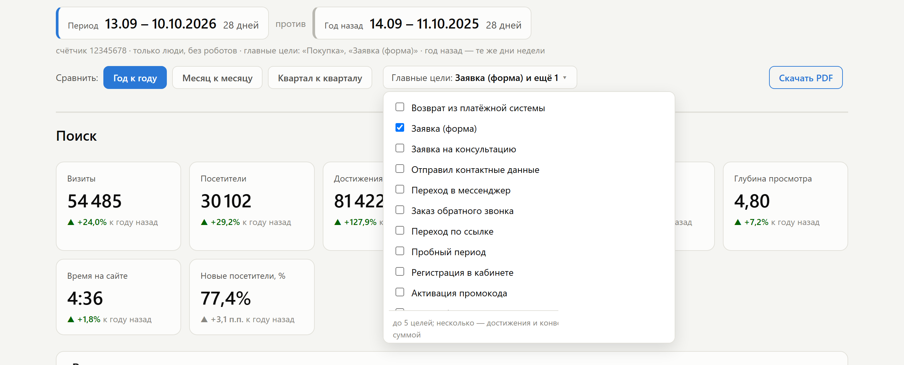

- **В панели** цели отмечаются галочками при первом нажатии кнопки отчёта.
- **На странице отчёта** — список «Главные цели» → галочки → «Пересчитать»: отчёт
  соберётся заново по новым целям и откроется сам.
- **Несколько целей, до пяти** — например, заявка, звонок и покупка. Тогда
  достижения складываются, цена цели — расход, делённый на их сумму, конверсия —
  тоже сумма по целям (визит, где сработали две цели, считается дважды — так же
  Метрика считает «достижения целей»). В подписи так и написано: «Конверсия в
  выбранные цели (сумма)».
- **В командной строке** — `--goal` с номером цели или частью названия, несколько —
  через запятую: `python run.py direct 12345678 --goal "Покупка,Заявка"`. Без
  `--goal` скрипт покажет цели счётчика с номерами — заявки и покупки сверху.
- Если целей в счётчике нет, отчёт строится и без них.

Достижения главных целей наложены на графики: оранжевым рядом с синими визитами —
по дням, неделям, страницам, кампаниям, источникам.

---

## Сравнение: год, месяц, квартал

На странице отчёта под датами — кнопки **«Год к году»**, **«Месяц к месяцу»**,
**«Квартал к кварталу»**. Нажали — отчёт пересчитывается с полоской прогресса и
сам открывается заново, когда готов. Кнопки работают, когда отчёт открыт через
панель (`python run.py panel`); у файла, открытого двойным щелчком, они выключены.

| Кнопка | Что с чем сравнивается |
|---|---|
| Год к году | последние 28 дней по вчера против тех же дней недели год назад |
| Месяц к месяцу | последний полный месяц против предыдущего (в октябре — сентябрь против августа) |
| Квартал к кварталу | последний полный квартал против предыдущего (в октябре — III квартал против II) |

Из командной строки то же самое — ключ `--compare yoy`, `--compare mom` или
`--compare qoq`. Он есть у всех отчётов: `seo`, `direct` и `report`.

---

## Если Метрика отстаёт с данными

После сбоев Яндекс досчитывает статистику с опозданием. Так было в октябре 2026:
12.10 у всех счётчиков были только первые часы 11.10 и пусто за 12.10, при этом
API не предупреждало об отставании ни словом. Отчёт «по вчера» в такие дни
заканчивается обрывом в ноль — и выглядит как обвал трафика.

Поэтому перед каждым отчётом скрипт проверяет последние две недели по дням. День,
в котором визитов меньше трети от обычного (медианы предыдущих семи дней), он
считает недосчитанным и идёт назад до последнего полного дня. Дальше:

- **период по умолчанию** (N дней по вчера, «год к году») — сдвигается целиком:
  и текущий, и сравниваемый период уходят назад на те же дни, длина не меняется.
  На странице и в Сводке — жёлтая плашка, как на [скриншоте отчёта по
  Директу](#отчёт-по-яндекс-директу): за какие дни данных нет и на какие даты
  сдвинут отчёт;
- **месяц, квартал и точные даты** (`--from`/`--to`) не двигаются — только та же
  плашка-предупреждение.

Когда данные появятся, перевыгрузите отчёт — период снова будет по вчера. На
маленьких сайтах, где обычно меньше 20 визитов в день, проверка не включается:
там провал в один день — обычное дело.

---

## PDF для клиента

Рядом с Excel и страницей отчёта ложится `dashboard_….pdf` — та же страница на
листах A4. Шапки с логотипом и кнопок в нём нет; внизу каждого листа —
колонтитул со ссылками на сайт и Telegram-канал и номер страницы.

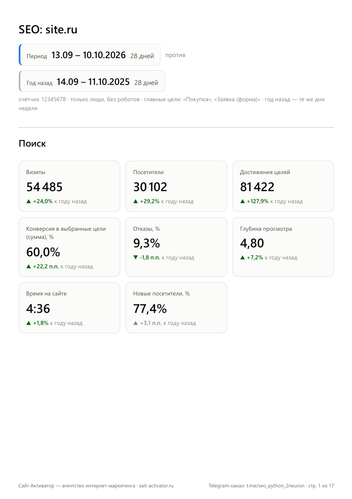

- На странице отчёта — кнопка **«Скачать PDF»**, в списках отчётов на вкладках
  «SEO» и «Директ» — ссылка «PDF».
- Печатает его браузер Chrome или Edge: он должен быть установлен, окно при этом
  не откроется. Нет ни того ни другого — отчёт соберётся без PDF.
- Подписи в колонтитуле меняются там же, где шапка, — [см. ниже](#своя-шапка-логотип-и-кнопки).

---

## Только люди: роботы не считаются

Все отчёты скилла считают только людей — как фильтр «Роботность: только люди» в
интерфейсе Метрики. Роботы — это до 15–20 % визитов, и они сильнее всего
искажают отказы, время на сайте и длинные клики. В Сводке и на странице отчёта
так и написано: «только люди, без роботов». Клики и расход Директа роботов не
различают — их скрипт берёт как есть.

Нужны все визиты вместе с роботами — добавьте `--with-robots` к любой команде.

---

## Обычный отчёт Метрики в Excel

Без панели и без главных целей — все стандартные отчёты Метрики одним файлом.
Удобно, когда нужно просто выгрузить статистику: клиенту, для сравнения периодов,
по десятку сайтов подряд.

```powershell
python run.py report 12345678
```

Это отчёт за последние 30 дней по вчера; сравнение — с 30 днями до них. Занимает
20–30 секунд:

```
   счётчик 12345678 · site.ru · 12.09.2026–11.10.2026 (30 дн.) · сравнение с 13.08.2026–11.09.2026
   Динамика…
   Источники…
   …
   Города…
   панель с графиками…
✅ листов: 18 из 18 + Панель
✅ файл: C:\metrika-export\data\12345678_site.ru\metrika_site.ru_2026-09-12_2026-10-11.xlsx
✅ панель в браузере: C:\metrika-export\data\12345678_site.ru\dashboard_site.ru_2026-09-12_2026-10-11.html
```

| Лист | Что на нём |
|---|---|
| **Панель** | главные цифры плитками и графики |
| **Сводка** | итоги периода и прошлого периода такой же длины: визиты, посетители, просмотры, отказы, глубина, время на сайте, новые посетители, достижения целей, конверсия — и изменение. Ниже — список листов: сколько строк, полные ли данные |
| Динамика | всё то же по дням, неделям или месяцам |
| Источники | поиск, реклама, ссылки, прямые заходы, соцсети… |
| Поисковые системы | Яндекс, Google и другие |
| Поисковые фразы | по каким запросам пришли |
| Сайты-источники | переходы по ссылкам с других сайтов |
| Рекламные системы | Директ, Google Ads и другие |
| Соцсети | ВКонтакте, Telegram и другие |
| UTM-метки | source / medium / campaign |
| Страницы входа | с каких страниц начинались визиты |
| Популярные страницы | самые просматриваемые страницы |
| Цели | каждая цель: тип, достижения, конверсия |
| Цели по источникам | каждая цель по источникам трафика: сколько достижений дал источник, его доля в цели, конверсия визитов из него. Фильтр по колонке «Цель» — источники одной цели |
| Устройства, ОС, Браузеры | ПК и смартфоны, системы, браузеры |
| Страны, Города | география |

Рядом с Excel — `dashboard_<сайт>_<начало>_<конец>.html`: та же панель для
браузера. Открывается двойным щелчком, интернет не нужен: картинки встроены в
сам файл. И папка `charts_<начало>_<конец>` — каждый график отдельной картинкой
PNG, для презентации. Это же есть у SEO-отчёта и отчёта по Директу.

| Команда | Что делает |
|---|---|
| `python run.py report site.ru` | счётчик по адресу сайта вместо номера |
| `python run.py report 12345678 --days 90` | последние 90 дней |
| `python run.py report 12345678 --from 2026-09-01 --to 2026-09-30` | точный период |
| `python run.py report 12345678 --compare yoy` | год к году |
| `python run.py report 12345678 --goal "Заявка"` | конверсия по главной цели вместо «любой цели»; в обычном отчёте необязательна |
| `python run.py report 12345678 --group week` | динамика по неделям (`day`, `week`, `month`). По умолчанию сам: до 2 месяцев — по дням, до года — по неделям, дальше — по месяцам |
| `python run.py report 12345678 --only sources,phrases,goals` | только нужные листы |
| `python run.py report 12345678 --top 100000` | больше строк на лист (по умолчанию 10 000) |
| `python run.py report 12345678 --no-compare` | без сравнения с прошлым периодом |
| `python run.py report 12345678 --no-charts` | без панели с графиками — только таблицы |

Названия листов для `--only`: `dynamics`, `sources`, `engines`, `phrases`,
`referrals`, `ads`, `social`, `utm`, `entry`, `pages`, `goals`, `goal_sources`, `devices`,
`os`, `browsers`, `countries`, `cities`.

Если по адресу сайта подходит несколько счётчиков — например, сайт и его
карточки на Картах, — скрипт покажет их и попросит указать номер.

---

## Как читать Excel

- **Сводка** — начните с неё. Колонка «Изменение»: для визитов, просмотров и
  других количеств — на сколько процентов изменилось; для долей в процентах
  (отказы, конверсия, новые посетители) — разница в процентных пунктах.
- **Ниже в Сводке — список листов.** «Строк в файле» и «Всего в Метрике»: если
  второе больше, лист обрезан по `--top` — так бывает со страницами и фразами на
  больших сайтах. «Данные: полные» — всё точно; «выборка N %» — см. раздел про
  перегрузку API.
- **«Итого и в среднем»** — первая строка каждого листа, над шапкой; на всех
  столбцах — фильтры. На листах с группировкой итог считается только по строкам,
  где значение определено: например, сумма по городам меньше общего числа визитов,
  потому что у части визитов город не определился.
- **Жёлтая плашка «Данные за … похоже, неполные»** — в последний день визитов в
  разы меньше обычного, а период не сдвигался (месяц, квартал или точные даты).
  На графике этот день нарисован пунктиром. Перевыгрузите отчёт позже — цифры
  подтянутся. Если плашка осталась — трафик и правда упал.
- **Источник визита — последний значимый**, как в интерфейсе Метрики по
  умолчанию: если человек пришёл из поиска, а потом зашёл напрямую, визит
  засчитается поиску.
- **Поисковые фразы** — поисковики скрывают большую часть запросов, поэтому
  фраз в отчёте всегда меньше, чем переходов из поиска. Так в интерфейсе тоже.
- **Динамика по неделям и месяцам** в обычном отчёте — по календарным неделям (с
  понедельника) и месяцам, поэтому первая и последняя строки бывают неполными.
- **Время на сайте** — в формате часы:минуты:секунды; Excel считает его как
  время, сортировка работает.
- **Цели** — тип цели по-русски, как в интерфейсе: «JavaScript-событие»,
  «Посещение страниц», «Время на сайте»…

Цифры совпадают с интерфейсом Метрики при тех же настройках: фильтр «только
люди», атрибуция «последний значимый переход», точность 100 %.

---

## Свой отчёт: любые метрики и группировки

Для тех, кто знает API Метрики: команда `raw` выгружает в Excel любой отчёт.

```powershell
python run.py raw 12345678 --metrics ym:s:visits,ym:s:users --dimensions ym:s:lastsignTrafficSource,ym:s:deviceCategory --days 30
python run.py raw 12345678 --metrics ym:s:visits --dimensions ym:s:startURL --sort -ym:s:visits --top 500
```

Названия группировок — в [списке группировок](https://yandex.ru/dev/metrika/ru/stat/attrandmetr/dim_all),
метрики и примеры запросов — в [документации API отчётов](https://yandex.ru/dev/metrika/ru/stat/).
В одном запросе — до 20 метрик. Файл ляжет в `data\<счётчик>_<сайт>\raw_<дата>.xlsx`.

---

## С Claude Code

Необязательно. Если у вас есть Claude Code, откройте его в папке скилла
(`claude` в терминале) и попросите обычными словами:

```
Собери SEO-отчёт по site.ru год к году и скажи, какие страницы потеряли поиск.
```

```
Открой панель Метрики.
```

Claude прочитает `SKILL.md`, спросит, какие цели главные, сам запустит `run.py`,
откроет Excel и перескажет главное: откуда упал или вырос трафик, какие страницы,
кампании и часы дают дорогие цели. Токен он не увидит и не выведет — скрипт берёт
его из `.env` сам.

---

## Своя шапка: логотип и кнопки

Шапка панели и страниц отчётов — логотип и две кнопки — настраивается в начале
`charts.py`, в блоке `BRAND`: адрес сайта, подписи и ссылки кнопок. Логотип —
файл `logo.png` рядом со скриптом: замените его своим (картинка на белом фоне,
высотой 120–170 пикселей; на экране она показывается высотой 46). Логотип
встраивается в страницу, интернет для него не нужен.

Подписи в колонтитуле PDF — в функции `print_css` в `charts.py`.

---

## Лимиты и перегрузка API

Ограничения API Метрики (из документации Яндекса):

| Лимит | Значение |
|---|---|
| Запросов в секунду с одного IP | 30 |
| Одновременных запросов | 3 |
| Запросов в сутки | 5 000 |
| Отчётов на один счётчик | 200 за 5 минут |

Обычный отчёт — 20–30 запросов, SEO и Директ — в несколько раз больше; скрипт
делает их по одному с паузой. Запаса хватит на десятки отчётов в день. Если лимит всё же кончится —
API ответит «подождите», и скрипт подождёт сам.

**Если API перегружено**, оно отвечает «Запрос слишком сложный». Скрипт:

1. несколько раз повторяет запрос с нарастающей паузой — обычно этого хватает;
2. если не помогло — берёт **выборку**: сначала 50 % визитов, потом 10 %.
   Цифры по выборке приблизительные, и такой лист помечается в Сводке как
   «выборка N %»;
3. если не получилось и так — лист будет с причиной, остальные листы
   выгрузятся всё равно.

Перезапустите отчёт позже — и получите полные данные.

---

## Частые ошибки

| Что видите | Что делать |
|---|---|
| `python : Имя "python" не распознано…` или открылся Microsoft Store | шаг 1: галочка **Add python.exe to PATH**, отключить псевдонимы Store, открыть терминал заново |
| `Нет библиотеки (requests)` или `(openpyxl)` | в папке скилла: `python -m pip install -r requirements.txt` |
| `панель с графиками пропущена: нет seaborn` | Excel соберётся без листа «Панель». Для графиков: `python -m pip install -r requirements.txt` |
| `панель с графиками не собрана: …` | таблицы сохранены, не получились только графики. Перешлите текст ошибки — или запустите с `--no-charts` |
| `Выберите главную цель…` | SEO и Директ без главной цели не строятся — добавьте `--goal` с номером из списка, который покажет скрипт, или отметьте цели в панели |
| Жёлтая плашка «Метрика не отдаёт полные данные после …» | Яндекс ещё не досчитал последние дни; отчёт сдвинут на последний полный день — [подробнее](#если-метрика-отстаёт-с-данными). Перевыгрузите позже |
| `PDF не собран: для него нужен Chrome или Edge` | установите Chrome или Edge; без них всё остальное собирается как обычно |
| Кнопки «Год к году» и «Пересчитать» не нажимаются | отчёт открыт файлом, а не через панель: запустите `python run.py panel` и откройте его на вкладке «SEO» или «Директ» |
| `API ответило 429: Превышена квота…` | дневная квота API на счётчик исчерпана — часто это делают другие пользователи с гостевым доступом. Доступ откроется в начале следующих суток |
| `METRIKA_TOKEN не найден` | нет файла `.env` рядом с `run.py`, или он называется `.env.txt` — шаг 3.3 |
| `401` или `403: токен не подошёл` | токен скопирован не полностью, отозван или истёк; ещё — вы сменили пароль или настройки двухфакторной защиты. Получите новый (шаг 3.2) |
| `Счётчика … нет среди доступных этому токену` | токен от другого аккаунта Яндекса или к счётчику нет доступа: `python run.py counters` покажет, что доступно |
| `По «…» подходит несколько счётчиков` | укажите номер из списка, который покажет скрипт |
| `нет доступа (403)` на отдельном листе | у аккаунта нет прав на эти данные — например, на цели в чужом счётчике |
| В отчёте по Директу нет расходов | у аккаунта токена нет доступа к рекламному кабинету — [подробнее](#расходы-нужен-доступ-к-директу) |
| `API ответило 503, жду…` или `API перегружено…` | скрипт подождёт и повторит сам. Не прошло — перезапустите позже |
| `API Метрики недоступно` | нет интернета или API лежит целиком — попробуйте позже |
| Лист в Сводке «выборка 10 %» | API было перегружено. Перезапустите отчёт позже — данные будут полные |
| Порт 8790 занят | `python run.py panel --port 8791` |
| Кракозябры вместо русских букв в терминале | выполните `chcp 65001` и запустите снова |

---

## Куда уходят ваши данные

- **Токен** лежит только в `.env` у вас и уходит только в API Метрики
  (`api-metrika.yandex.net`) — больше никуда.
- **Отчёты** сохраняются в папку `data\` рядом со скриптом. Графики и PDF
  делаются тоже у вас, без внешних сервисов.
- **Панель** открывается только на вашем компьютере (`127.0.0.1`): из сети к ней
  не подключиться.
- В `dashboard_….html` и PDF — ваша статистика: пересылайте их тем, кому показали
  бы и сам Excel.
- **`.gitignore`** не даёт `.env` и `data\` попасть в git, если вы выложите
  папку на GitHub.
